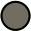
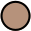
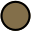
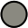
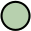

<!-- Generated by scripts/generate-palette.py from palette.json. Do not edit. -->

# Kanagawa style guide

How to apply the [palette](PALETTE.md) in a port. Find the role of the thing
you are theming, then use the color listed for your variant. Every port
provides Wave, Dragon, and Lotus.

> [!IMPORTANT]
> These are guidelines. Some cases need a deviation, such as text on a colored
> background. Legibility comes first, so use your own judgment, and check the
> contrast of each foreground and background pair you ship.

Colors are named as in the [palette](PALETTE.md), which also lists their values.

Roles come from the Neovim theme, so they cover what an editor needs. For
anything else, pick the closest role, for example `syn.string` for any string-like
value and `diag.error` for any error state. If no role fits, open an issue in
this repository before inventing a color.

<table>
  <thead>
    <tr><th colspan="8">Interface</th></tr>
    <tr><th>Role</th><th>Use</th><th colspan="2">Wave</th><th colspan="2">Dragon</th><th colspan="2">Lotus</th></tr>
  </thead>
  <tbody>
    <tr><td><code>ui.fg</code></td><td>Default foreground</td><td width="48" align="center"></td><td>fujiWhite</td><td width="48" align="center"></td><td>dragonWhite</td><td width="48" align="center"></td><td>lotusInk1</td></tr>
    <tr><td><code>ui.fg_dim</code></td><td>Dimmed foreground (statuslines)</td><td width="48" align="center"></td><td>oldWhite</td><td width="48" align="center"></td><td>oldWhite</td><td width="48" align="center"></td><td>lotusInk2</td></tr>
    <tr><td><code>ui.fg_reverse</code></td><td>Foreground on reversed highlights</td><td width="48" align="center"></td><td>waveBlue1</td><td width="48" align="center"></td><td>waveBlue1</td><td width="48" align="center"></td><td>lotusGray</td></tr>
    <tr><td><code>ui.bg_dim</code></td><td>Dimmed background</td><td width="48" align="center"></td><td>sumiInk1</td><td width="48" align="center"></td><td>dragonBlack1</td><td width="48" align="center"></td><td>lotusWhite1</td></tr>
    <tr><td><code>ui.bg_gutter</code></td><td>Gutter background (sign and fold columns, line numbers)</td><td width="48" align="center"></td><td>sumiInk4</td><td width="48" align="center"></td><td>dragonBlack4</td><td width="48" align="center"></td><td>lotusWhite4</td></tr>
    <tr><td><code>ui.bg_m3</code></td><td>Background, three steps darker (statuslines, floats)</td><td width="48" align="center"></td><td>sumiInk0</td><td width="48" align="center"></td><td>dragonBlack0</td><td width="48" align="center"></td><td>lotusWhite0</td></tr>
    <tr><td><code>ui.bg_m2</code></td><td>Background, two steps darker</td><td width="48" align="center"></td><td>sumiInk1</td><td width="48" align="center"></td><td>dragonBlack1</td><td width="48" align="center"></td><td>lotusWhite1</td></tr>
    <tr><td><code>ui.bg_m1</code></td><td>Background, one step darker</td><td width="48" align="center"></td><td>sumiInk2</td><td width="48" align="center"></td><td>dragonBlack2</td><td width="48" align="center"></td><td>lotusWhite2</td></tr>
    <tr><td><code>ui.bg</code></td><td>Default background</td><td width="48" align="center"></td><td>sumiInk3</td><td width="48" align="center"></td><td>dragonBlack3</td><td width="48" align="center"></td><td>lotusWhite3</td></tr>
    <tr><td><code>ui.bg_p1</code></td><td>Background, one step lighter (colorcolumn, folds)</td><td width="48" align="center"></td><td>sumiInk4</td><td width="48" align="center"></td><td>dragonBlack4</td><td width="48" align="center"></td><td>lotusWhite4</td></tr>
    <tr><td><code>ui.bg_p2</code></td><td>Background, two steps lighter (cursorline, selected items)</td><td width="48" align="center"></td><td>sumiInk5</td><td width="48" align="center"></td><td>dragonBlack5</td><td width="48" align="center"></td><td>lotusWhite5</td></tr>
    <tr><td><code>ui.special</code></td><td>Special keys</td><td width="48" align="center"></td><td>springViolet1</td><td width="48" align="center"></td><td>dragonGray3</td><td width="48" align="center"></td><td>lotusViolet2</td></tr>
    <tr><td><code>ui.nontext</code></td><td>Non-text characters, line numbers</td><td width="48" align="center"></td><td>sumiInk6</td><td width="48" align="center"></td><td>dragonBlack6</td><td width="48" align="center"></td><td>lotusViolet1</td></tr>
    <tr><td><code>ui.whitespace</code></td><td>Whitespace characters</td><td width="48" align="center"></td><td>sumiInk6</td><td width="48" align="center"></td><td>dragonBlack6</td><td width="48" align="center"></td><td>lotusViolet1</td></tr>
    <tr><td><code>ui.bg_search</code></td><td>Search background</td><td width="48" align="center"></td><td>waveBlue2</td><td width="48" align="center"></td><td>waveBlue2</td><td width="48" align="center"></td><td>lotusBlue2</td></tr>
    <tr><td><code>ui.bg_visual</code></td><td>Visual selection background</td><td width="48" align="center"></td><td>waveBlue1</td><td width="48" align="center"></td><td>waveBlue1</td><td width="48" align="center"></td><td>lotusViolet3</td></tr>
  </tbody>
</table>

<table>
  <thead>
    <tr><th colspan="8">Popup menu</th></tr>
    <tr><th>Role</th><th>Use</th><th colspan="2">Wave</th><th colspan="2">Dragon</th><th colspan="2">Lotus</th></tr>
  </thead>
  <tbody>
    <tr><td><code>ui.pmenu.fg</code></td><td>Popup menu foreground</td><td width="48" align="center"></td><td>fujiWhite</td><td width="48" align="center"></td><td>fujiWhite</td><td width="48" align="center"></td><td>lotusInk2</td></tr>
    <tr><td><code>ui.pmenu.bg</code></td><td>Popup menu background</td><td width="48" align="center"></td><td>waveBlue1</td><td width="48" align="center"></td><td>waveBlue1</td><td width="48" align="center"></td><td>lotusBlue1</td></tr>
    <tr><td><code>ui.pmenu.bg_sel</code></td><td>Popup menu selection background</td><td width="48" align="center"></td><td>waveBlue2</td><td width="48" align="center"></td><td>waveBlue2</td><td width="48" align="center"></td><td>lotusBlue3</td></tr>
    <tr><td><code>ui.pmenu.bg_sbar</code></td><td>Popup menu scrollbar background</td><td width="48" align="center"></td><td>waveBlue1</td><td width="48" align="center"></td><td>waveBlue1</td><td width="48" align="center"></td><td>lotusBlue1</td></tr>
    <tr><td><code>ui.pmenu.bg_thumb</code></td><td>Popup menu scrollbar thumb</td><td width="48" align="center"></td><td>waveBlue2</td><td width="48" align="center"></td><td>waveBlue2</td><td width="48" align="center"></td><td>lotusBlue2</td></tr>
  </tbody>
</table>

<table>
  <thead>
    <tr><th colspan="8">Floating windows</th></tr>
    <tr><th>Role</th><th>Use</th><th colspan="2">Wave</th><th colspan="2">Dragon</th><th colspan="2">Lotus</th></tr>
  </thead>
  <tbody>
    <tr><td><code>ui.float.fg</code></td><td>Floating window foreground</td><td width="48" align="center"></td><td>oldWhite</td><td width="48" align="center"></td><td>oldWhite</td><td width="48" align="center"></td><td>lotusInk2</td></tr>
    <tr><td><code>ui.float.bg</code></td><td>Floating window background</td><td width="48" align="center"></td><td>sumiInk0</td><td width="48" align="center"></td><td>dragonBlack0</td><td width="48" align="center"></td><td>lotusWhite0</td></tr>
    <tr><td><code>ui.float.fg_border</code></td><td>Floating window border</td><td width="48" align="center"></td><td>sumiInk6</td><td width="48" align="center"></td><td>sumiInk6</td><td width="48" align="center"></td><td>lotusGray2</td></tr>
    <tr><td><code>ui.float.bg_border</code></td><td>Floating window border background</td><td width="48" align="center"></td><td>sumiInk0</td><td width="48" align="center"></td><td>dragonBlack0</td><td width="48" align="center"></td><td>lotusWhite0</td></tr>
  </tbody>
</table>

<table>
  <thead>
    <tr><th colspan="8">Syntax</th></tr>
    <tr><th>Role</th><th>Use</th><th colspan="2">Wave</th><th colspan="2">Dragon</th><th colspan="2">Lotus</th></tr>
  </thead>
  <tbody>
    <tr><td><code>syn.string</code></td><td>Strings</td><td width="48" align="center"></td><td>springGreen</td><td width="48" align="center"></td><td>dragonGreen2</td><td width="48" align="center"></td><td>lotusGreen</td></tr>
    <tr><td><code>syn.number</code></td><td>Numbers</td><td width="48" align="center"></td><td>sakuraPink</td><td width="48" align="center"></td><td>dragonPink</td><td width="48" align="center"></td><td>lotusPink</td></tr>
    <tr><td><code>syn.constant</code></td><td>Constants, imports, booleans</td><td width="48" align="center"></td><td>surimiOrange</td><td width="48" align="center"></td><td>dragonOrange</td><td width="48" align="center"></td><td>lotusOrange</td></tr>
    <tr><td><code>syn.identifier</code></td><td>Identifiers</td><td width="48" align="center"></td><td>carpYellow</td><td width="48" align="center"></td><td>dragonYellow</td><td width="48" align="center"></td><td>lotusYellow</td></tr>
    <tr><td><code>syn.parameter</code></td><td>Parameters</td><td width="48" align="center"></td><td>oniViolet2</td><td width="48" align="center"></td><td>dragonGray</td><td width="48" align="center"></td><td>lotusBlue5</td></tr>
    <tr><td><code>syn.fun</code></td><td>Functions and titles</td><td width="48" align="center"></td><td>crystalBlue</td><td width="48" align="center"></td><td>dragonBlue2</td><td width="48" align="center"></td><td>lotusBlue4</td></tr>
    <tr><td><code>syn.statement</code></td><td>Statements</td><td width="48" align="center"></td><td>oniViolet</td><td width="48" align="center"></td><td>dragonViolet</td><td width="48" align="center"></td><td>lotusViolet4</td></tr>
    <tr><td><code>syn.keyword</code></td><td>Keywords</td><td width="48" align="center"></td><td>oniViolet</td><td width="48" align="center"></td><td>dragonViolet</td><td width="48" align="center"></td><td>lotusViolet4</td></tr>
    <tr><td><code>syn.operator</code></td><td>Operators</td><td width="48" align="center"></td><td>boatYellow2</td><td width="48" align="center"></td><td>dragonRed</td><td width="48" align="center"></td><td>lotusYellow2</td></tr>
    <tr><td><code>syn.preproc</code></td><td>Preprocessor</td><td width="48" align="center"></td><td>waveRed</td><td width="48" align="center"></td><td>dragonRed</td><td width="48" align="center"></td><td>lotusRed</td></tr>
    <tr><td><code>syn.type</code></td><td>Types</td><td width="48" align="center"></td><td>waveAqua2</td><td width="48" align="center"></td><td>dragonAqua</td><td width="48" align="center"></td><td>lotusAqua</td></tr>
    <tr><td><code>syn.regex</code></td><td>Regular expressions</td><td width="48" align="center"></td><td>boatYellow2</td><td width="48" align="center"></td><td>dragonRed</td><td width="48" align="center"></td><td>lotusYellow2</td></tr>
    <tr><td><code>syn.deprecated</code></td><td>Deprecated</td><td width="48" align="center"></td><td>katanaGray</td><td width="48" align="center"></td><td>katanaGray</td><td width="48" align="center"></td><td>lotusGray3</td></tr>
    <tr><td><code>syn.comment</code></td><td>Comments</td><td width="48" align="center"></td><td>fujiGray</td><td width="48" align="center"></td><td>dragonAsh</td><td width="48" align="center"></td><td>lotusGray3</td></tr>
    <tr><td><code>syn.punct</code></td><td>Brackets and punctuation</td><td width="48" align="center"></td><td>springViolet2</td><td width="48" align="center"></td><td>dragonGray2</td><td width="48" align="center"></td><td>lotusTeal1</td></tr>
    <tr><td><code>syn.special1</code></td><td>Specials and builtin functions</td><td width="48" align="center"></td><td>springBlue</td><td width="48" align="center"></td><td>dragonTeal</td><td width="48" align="center"></td><td>lotusTeal2</td></tr>
    <tr><td><code>syn.special2</code></td><td>Standout specials 1 (builtin variables)</td><td width="48" align="center"></td><td>waveRed</td><td width="48" align="center"></td><td>dragonRed</td><td width="48" align="center"></td><td>lotusRed</td></tr>
    <tr><td><code>syn.special3</code></td><td>Standout specials 2 (exception handling, return)</td><td width="48" align="center"></td><td>peachRed</td><td width="48" align="center"></td><td>dragonRed</td><td width="48" align="center"></td><td>lotusRed</td></tr>
  </tbody>
</table>

<table>
  <thead>
    <tr><th colspan="8">Version control</th></tr>
    <tr><th>Role</th><th>Use</th><th colspan="2">Wave</th><th colspan="2">Dragon</th><th colspan="2">Lotus</th></tr>
  </thead>
  <tbody>
    <tr><td><code>vcs.added</code></td><td>Version control: added</td><td width="48" align="center"></td><td>autumnGreen</td><td width="48" align="center"></td><td>autumnGreen</td><td width="48" align="center"></td><td>lotusGreen2</td></tr>
    <tr><td><code>vcs.removed</code></td><td>Version control: removed</td><td width="48" align="center"></td><td>autumnRed</td><td width="48" align="center"></td><td>autumnRed</td><td width="48" align="center"></td><td>lotusRed2</td></tr>
    <tr><td><code>vcs.changed</code></td><td>Version control: changed</td><td width="48" align="center"></td><td>autumnYellow</td><td width="48" align="center"></td><td>autumnYellow</td><td width="48" align="center"></td><td>lotusYellow3</td></tr>
  </tbody>
</table>

<table>
  <thead>
    <tr><th colspan="8">Diff</th></tr>
    <tr><th>Role</th><th>Use</th><th colspan="2">Wave</th><th colspan="2">Dragon</th><th colspan="2">Lotus</th></tr>
  </thead>
  <tbody>
    <tr><td><code>diff.add</code></td><td>Diff added (background)</td><td width="48" align="center"></td><td>winterGreen</td><td width="48" align="center"></td><td>winterGreen</td><td width="48" align="center"></td><td>lotusGreen3</td></tr>
    <tr><td><code>diff.delete</code></td><td>Diff deleted (background)</td><td width="48" align="center"></td><td>winterRed</td><td width="48" align="center"></td><td>winterRed</td><td width="48" align="center"></td><td>lotusRed4</td></tr>
    <tr><td><code>diff.change</code></td><td>Diff changed line (background)</td><td width="48" align="center"></td><td>winterBlue</td><td width="48" align="center"></td><td>winterBlue</td><td width="48" align="center"></td><td>lotusCyan</td></tr>
    <tr><td><code>diff.text</code></td><td>Diff changed text (background)</td><td width="48" align="center"></td><td>winterYellow</td><td width="48" align="center"></td><td>winterYellow</td><td width="48" align="center"></td><td>lotusYellow4</td></tr>
  </tbody>
</table>

<table>
  <thead>
    <tr><th colspan="8">Diagnostics</th></tr>
    <tr><th>Role</th><th>Use</th><th colspan="2">Wave</th><th colspan="2">Dragon</th><th colspan="2">Lotus</th></tr>
  </thead>
  <tbody>
    <tr><td><code>diag.ok</code></td><td>Diagnostic ok</td><td width="48" align="center"></td><td>springGreen</td><td width="48" align="center"></td><td>springGreen</td><td width="48" align="center"></td><td>lotusGreen</td></tr>
    <tr><td><code>diag.error</code></td><td>Diagnostic error</td><td width="48" align="center"></td><td>samuraiRed</td><td width="48" align="center"></td><td>samuraiRed</td><td width="48" align="center"></td><td>lotusRed3</td></tr>
    <tr><td><code>diag.warning</code></td><td>Diagnostic warning</td><td width="48" align="center"></td><td>roninYellow</td><td width="48" align="center"></td><td>roninYellow</td><td width="48" align="center"></td><td>lotusOrange2</td></tr>
    <tr><td><code>diag.info</code></td><td>Diagnostic info</td><td width="48" align="center"></td><td>dragonBlue</td><td width="48" align="center"></td><td>dragonBlue</td><td width="48" align="center"></td><td>lotusTeal3</td></tr>
    <tr><td><code>diag.hint</code></td><td>Diagnostic hint</td><td width="48" align="center"></td><td>waveAqua1</td><td width="48" align="center"></td><td>waveAqua1</td><td width="48" align="center"></td><td>lotusAqua2</td></tr>
  </tbody>
</table>

<table>
  <thead>
    <tr><th colspan="8">Terminal</th></tr>
    <tr><th>Role</th><th>Use</th><th colspan="2">Wave</th><th colspan="2">Dragon</th><th colspan="2">Lotus</th></tr>
  </thead>
  <tbody>
    <tr><td><code>term.black</code></td><td>ANSI 0</td><td width="48" align="center"></td><td>sumiInk0</td><td width="48" align="center"></td><td>dragonBlack0</td><td width="48" align="center"></td><td>sumiInk3</td></tr>
    <tr><td><code>term.red</code></td><td>ANSI 1</td><td width="48" align="center"></td><td>autumnRed</td><td width="48" align="center"></td><td>dragonRed</td><td width="48" align="center"></td><td>lotusRed</td></tr>
    <tr><td><code>term.green</code></td><td>ANSI 2</td><td width="48" align="center"></td><td>autumnGreen</td><td width="48" align="center"></td><td>dragonGreen2</td><td width="48" align="center"></td><td>lotusGreen</td></tr>
    <tr><td><code>term.yellow</code></td><td>ANSI 3</td><td width="48" align="center"></td><td>boatYellow2</td><td width="48" align="center"></td><td>dragonYellow</td><td width="48" align="center"></td><td>lotusYellow</td></tr>
    <tr><td><code>term.blue</code></td><td>ANSI 4</td><td width="48" align="center"></td><td>crystalBlue</td><td width="48" align="center"></td><td>dragonBlue2</td><td width="48" align="center"></td><td>lotusBlue4</td></tr>
    <tr><td><code>term.magenta</code></td><td>ANSI 5</td><td width="48" align="center"></td><td>oniViolet</td><td width="48" align="center"></td><td>dragonPink</td><td width="48" align="center"></td><td>lotusPink</td></tr>
    <tr><td><code>term.cyan</code></td><td>ANSI 6</td><td width="48" align="center"></td><td>waveAqua1</td><td width="48" align="center"></td><td>dragonAqua</td><td width="48" align="center"></td><td>lotusAqua</td></tr>
    <tr><td><code>term.white</code></td><td>ANSI 7</td><td width="48" align="center"></td><td>oldWhite</td><td width="48" align="center"></td><td>oldWhite</td><td width="48" align="center"></td><td>lotusInk1</td></tr>
    <tr><td><code>term.bright_black</code></td><td>ANSI 8</td><td width="48" align="center"></td><td>fujiGray</td><td width="48" align="center"></td><td>dragonGray</td><td width="48" align="center"></td><td>lotusGray3</td></tr>
    <tr><td><code>term.bright_red</code></td><td>ANSI 9</td><td width="48" align="center"></td><td>samuraiRed</td><td width="48" align="center"></td><td>waveRed</td><td width="48" align="center"></td><td>lotusRed2</td></tr>
    <tr><td><code>term.bright_green</code></td><td>ANSI 10</td><td width="48" align="center"></td><td>springGreen</td><td width="48" align="center"></td><td>dragonGreen</td><td width="48" align="center"></td><td>lotusGreen2</td></tr>
    <tr><td><code>term.bright_yellow</code></td><td>ANSI 11</td><td width="48" align="center"></td><td>carpYellow</td><td width="48" align="center"></td><td>carpYellow</td><td width="48" align="center"></td><td>lotusYellow2</td></tr>
    <tr><td><code>term.bright_blue</code></td><td>ANSI 12</td><td width="48" align="center"></td><td>springBlue</td><td width="48" align="center"></td><td>springBlue</td><td width="48" align="center"></td><td>lotusTeal2</td></tr>
    <tr><td><code>term.bright_magenta</code></td><td>ANSI 13</td><td width="48" align="center"></td><td>springViolet1</td><td width="48" align="center"></td><td>springViolet1</td><td width="48" align="center"></td><td>lotusViolet4</td></tr>
    <tr><td><code>term.bright_cyan</code></td><td>ANSI 14</td><td width="48" align="center"></td><td>waveAqua2</td><td width="48" align="center"></td><td>waveAqua2</td><td width="48" align="center"></td><td>lotusAqua2</td></tr>
    <tr><td><code>term.bright_white</code></td><td>ANSI 15</td><td width="48" align="center"></td><td>fujiWhite</td><td width="48" align="center"></td><td>dragonWhite</td><td width="48" align="center"></td><td>lotusInk2</td></tr>
    <tr><td><code>term.extended_1</code></td><td>ANSI 16</td><td width="48" align="center"></td><td>surimiOrange</td><td width="48" align="center"></td><td>dragonOrange</td><td width="48" align="center"></td><td>lotusOrange2</td></tr>
    <tr><td><code>term.extended_2</code></td><td>ANSI 17</td><td width="48" align="center"></td><td>peachRed</td><td width="48" align="center"></td><td>dragonOrange2</td><td width="48" align="center"></td><td>lotusRed3</td></tr>
  </tbody>
</table>

## Terminal notes

- Wave and Dragon map `term.black` to a background shade and `term.white` to a
  foreground shade. Lotus is a light variant but keeps a dark `term.black`.
- The two extended colors (`term.extended_1`, `term.extended_2`) are ANSI colors
  16 and 17.
