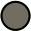
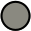

<!-- Generated by scripts/generate-palette.py from palette.json. Do not edit. -->

# Kanagawa palette

Every color a port needs, for each variant. Use these values instead of
sampling screenshots or guessing from an existing port. [palette.json](../palette.json)
is the source of truth for every port, including the Neovim plugin: a color
changes there first, and ports follow. This page and the swatches in
[assets/palette](../assets/palette/) are generated from it by
[scripts/generate-palette.py](../scripts/generate-palette.py).

Each color lists the roles it plays in its variant. A role keeps its meaning
across variants (`syn.string` is the string color in Wave, Dragon, and Lotus)
but its color changes, so map your port by role. Color names such as
`sumiInk3` are labels: variants can share a name or a hex value for different
roles.

Swatches are also published at stable raw URLs:

```text
https://raw.githubusercontent.com/kanagawa-community/.github/main/assets/palette/<variant>/<name>.svg
```

## Wave

Wave is a dark variant with 38 colors.

<details>
<summary>Show Wave palette</summary>

|                                       Swatch                                       | Name          | Hex       | RGB             | HSL              | Usage                                                              |
| :--------------------------------------------------------------------------------: | :------------ | :-------- | :-------------- | :--------------- | :----------------------------------------------------------------- |
|      | fujiWhite     | `#DCD7BA` | `220, 215, 186` | `51, 33%, 80%`   | `ui.fg`, `ui.pmenu.fg`, `term.bright_white`                        |
|       | oldWhite      | `#C8C093` | `200, 192, 147` | `51, 33%, 68%`   | `ui.fg_dim`, `ui.float.fg`, `term.white`                           |
|      | waveBlue1     | `#223249` | `34, 50, 73`    | `215, 36%, 21%`  | `ui.fg_reverse`, `ui.bg_visual`, `ui.pmenu.bg`, `ui.pmenu.bg_sbar` |
|       | sumiInk1      | `#181820` | `24, 24, 32`    | `240, 14%, 11%`  | `ui.bg_dim`, `ui.bg_m2`                                            |
|       | sumiInk4      | `#2A2A37` | `42, 42, 55`    | `240, 13%, 19%`  | `ui.bg_gutter`, `ui.bg_p1`                                         |
|       | sumiInk0      | `#16161D` | `22, 22, 29`    | `240, 14%, 10%`  | `ui.bg_m3`, `ui.float.bg`, `ui.float.bg_border`, `term.black`      |
|       | sumiInk2      | `#1A1A22` | `26, 26, 34`    | `240, 13%, 12%`  | `ui.bg_m1`                                                         |
|       | sumiInk3      | `#1F1F28` | `31, 31, 40`    | `240, 13%, 14%`  | `ui.bg`                                                            |
|       | sumiInk5      | `#363646` | `54, 54, 70`    | `240, 13%, 24%`  | `ui.bg_p2`                                                         |
|  | springViolet1 | `#938AA9` | `147, 138, 169` | `257, 15%, 60%`  | `ui.special`, `term.bright_magenta`                                |
|       | sumiInk6      | `#54546D` | `84, 84, 109`   | `240, 13%, 38%`  | `ui.nontext`, `ui.whitespace`, `ui.float.fg_border`                |
|      | waveBlue2     | `#2D4F67` | `45, 79, 103`   | `205, 39%, 29%`  | `ui.bg_search`, `ui.pmenu.bg_sel`, `ui.pmenu.bg_thumb`             |
|    | springGreen   | `#98BB6C` | `152, 187, 108` | `87, 37%, 58%`   | `syn.string`, `diag.ok`, `term.bright_green`                       |
|     | sakuraPink    | `#D27E99` | `210, 126, 153` | `341, 48%, 66%`  | `syn.number`                                                       |
|   | surimiOrange  | `#FFA066` | `255, 160, 102` | `23, 100%, 70%`  | `syn.constant`, `term.extended_1`                                  |
|     | carpYellow    | `#E6C384` | `230, 195, 132` | `39, 66%, 71%`   | `syn.identifier`, `term.bright_yellow`                             |
|     | oniViolet2    | `#B8B4D0` | `184, 180, 208` | `249, 23%, 76%`  | `syn.parameter`                                                    |
|    | crystalBlue   | `#7E9CD8` | `126, 156, 216` | `220, 54%, 67%`  | `syn.fun`, `term.blue`                                             |
|      | oniViolet     | `#957FB8` | `149, 127, 184` | `263, 29%, 61%`  | `syn.statement`, `syn.keyword`, `term.magenta`                     |
|    | boatYellow2   | `#C0A36E` | `192, 163, 110` | `39, 39%, 59%`   | `syn.operator`, `syn.regex`, `term.yellow`                         |
|        | waveRed       | `#E46876` | `228, 104, 118` | `353, 70%, 65%`  | `syn.preproc`, `syn.special2`                                      |
|      | waveAqua2     | `#7AA89F` | `122, 168, 159` | `168, 21%, 57%`  | `syn.type`, `term.bright_cyan`                                     |
|     | katanaGray    | `#717C7C` | `113, 124, 124` | `180, 5%, 46%`   | `syn.deprecated`                                                   |
|       | fujiGray      | `#727169` | `114, 113, 105` | `53, 4%, 43%`    | `syn.comment`, `term.bright_black`                                 |
|  | springViolet2 | `#9CABCA` | `156, 171, 202` | `220, 30%, 70%`  | `syn.punct`                                                        |
|     | springBlue    | `#7FB4CA` | `127, 180, 202` | `198, 41%, 65%`  | `syn.special1`, `term.bright_blue`                                 |
|       | peachRed      | `#FF5D62` | `255, 93, 98`   | `358, 100%, 68%` | `syn.special3`, `term.extended_2`                                  |
|    | autumnGreen   | `#76946A` | `118, 148, 106` | `103, 17%, 50%`  | `vcs.added`, `term.green`                                          |
|      | autumnRed     | `#C34043` | `195, 64, 67`   | `359, 52%, 51%`  | `vcs.removed`, `term.red`                                          |
|   | autumnYellow  | `#DCA561` | `220, 165, 97`  | `33, 64%, 62%`   | `vcs.changed`                                                      |
|    | winterGreen   | `#2B3328` | `43, 51, 40`    | `104, 12%, 18%`  | `diff.add`                                                         |
|      | winterRed     | `#43242B` | `67, 36, 43`    | `346, 30%, 20%`  | `diff.delete`                                                      |
|     | winterBlue    | `#252535` | `37, 37, 53`    | `240, 18%, 18%`  | `diff.change`                                                      |
|   | winterYellow  | `#49443C` | `73, 68, 60`    | `37, 10%, 26%`   | `diff.text`                                                        |
|     | samuraiRed    | `#E82424` | `232, 36, 36`   | `0, 81%, 53%`    | `diag.error`, `term.bright_red`                                    |
|    | roninYellow   | `#FF9E3B` | `255, 158, 59`  | `30, 100%, 62%`  | `diag.warning`                                                     |
|     | dragonBlue    | `#658594` | `101, 133, 148` | `199, 19%, 49%`  | `diag.info`                                                        |
|      | waveAqua1     | `#6A9589` | `106, 149, 137` | `163, 17%, 50%`  | `diag.hint`, `term.cyan`                                           |

</details>

## Dragon

Dragon is a dark variant with 46 colors.

<details>
<summary>Show Dragon palette</summary>

|                                        Swatch                                        | Name          | Hex       | RGB             | HSL             | Usage                                                                                  |
| :----------------------------------------------------------------------------------: | :------------ | :-------- | :-------------- | :-------------- | :------------------------------------------------------------------------------------- |
|    | dragonWhite   | `#C5C9C5` | `197, 201, 197` | `120, 4%, 78%`  | `ui.fg`, `term.bright_white`                                                           |
|       | oldWhite      | `#C8C093` | `200, 192, 147` | `51, 33%, 68%`  | `ui.fg_dim`, `ui.float.fg`, `term.white`                                               |
|      | waveBlue1     | `#223249` | `34, 50, 73`    | `215, 36%, 21%` | `ui.fg_reverse`, `ui.bg_visual`, `ui.pmenu.bg`, `ui.pmenu.bg_sbar`                     |
|   | dragonBlack1  | `#12120F` | `18, 18, 15`    | `60, 9%, 6%`    | `ui.bg_dim`, `ui.bg_m2`                                                                |
|   | dragonBlack4  | `#282727` | `40, 39, 39`    | `0, 1%, 15%`    | `ui.bg_gutter`, `ui.bg_p1`                                                             |
|   | dragonBlack0  | `#0D0C0C` | `13, 12, 12`    | `0, 4%, 5%`     | `ui.bg_m3`, `ui.float.bg`, `ui.float.bg_border`, `term.black`                          |
|   | dragonBlack2  | `#1D1C19` | `29, 28, 25`    | `45, 7%, 11%`   | `ui.bg_m1`                                                                             |
|   | dragonBlack3  | `#181616` | `24, 22, 22`    | `0, 4%, 9%`     | `ui.bg`                                                                                |
|   | dragonBlack5  | `#393836` | `57, 56, 54`    | `40, 3%, 22%`   | `ui.bg_p2`                                                                             |
|    | dragonGray3   | `#7A8382` | `122, 131, 130` | `173, 4%, 50%`  | `ui.special`                                                                           |
|   | dragonBlack6  | `#625E5A` | `98, 94, 90`    | `30, 4%, 37%`   | `ui.whitespace`, `ui.nontext`                                                          |
|      | waveBlue2     | `#2D4F67` | `45, 79, 103`   | `205, 39%, 29%` | `ui.bg_search`, `ui.pmenu.bg_sel`, `ui.pmenu.bg_thumb`                                 |
|      | fujiWhite     | `#DCD7BA` | `220, 215, 186` | `51, 33%, 80%`  | `ui.pmenu.fg`                                                                          |
|       | sumiInk6      | `#54546D` | `84, 84, 109`   | `240, 13%, 38%` | `ui.float.fg_border`                                                                   |
|   | dragonGreen2  | `#8A9A7B` | `138, 154, 123` | `91, 13%, 54%`  | `syn.string`, `term.green`                                                             |
|     | dragonPink    | `#A292A3` | `162, 146, 163` | `296, 8%, 61%`  | `syn.number`, `term.magenta`                                                           |
|   | dragonOrange  | `#B6927B` | `182, 146, 123` | `23, 29%, 60%`  | `syn.constant`, `term.extended_1`                                                      |
|   | dragonYellow  | `#C4B28A` | `196, 178, 138` | `41, 33%, 65%`  | `syn.identifier`, `term.yellow`                                                        |
|     | dragonGray    | `#A6A69C` | `166, 166, 156` | `60, 5%, 63%`   | `syn.parameter`, `term.bright_black`                                                   |
|    | dragonBlue2   | `#8BA4B0` | `139, 164, 176` | `199, 19%, 62%` | `syn.fun`, `term.blue`                                                                 |
|   | dragonViolet  | `#8992A7` | `137, 146, 167` | `222, 15%, 60%` | `syn.statement`, `syn.keyword`                                                         |
|      | dragonRed     | `#C4746E` | `196, 116, 110` | `4, 42%, 60%`   | `syn.operator`, `syn.preproc`, `syn.regex`, `syn.special2`, `syn.special3`, `term.red` |
|     | dragonAqua    | `#8EA4A2` | `142, 164, 162` | `175, 11%, 60%` | `syn.type`, `term.cyan`                                                                |
|     | katanaGray    | `#717C7C` | `113, 124, 124` | `180, 5%, 46%`  | `syn.deprecated`                                                                       |
|    | dragonGray2   | `#9E9B93` | `158, 155, 147` | `44, 5%, 60%`   | `syn.punct`                                                                            |
|      | dragonAsh     | `#737C73` | `115, 124, 115` | `120, 4%, 47%`  | `syn.comment`                                                                          |
|     | dragonTeal    | `#949FB5` | `148, 159, 181` | `220, 18%, 65%` | `syn.special1`                                                                         |
|     | samuraiRed    | `#E82424` | `232, 36, 36`   | `0, 81%, 53%`   | `diag.error`                                                                           |
|    | springGreen   | `#98BB6C` | `152, 187, 108` | `87, 37%, 58%`  | `diag.ok`                                                                              |
|    | roninYellow   | `#FF9E3B` | `255, 158, 59`  | `30, 100%, 62%` | `diag.warning`                                                                         |
|     | dragonBlue    | `#658594` | `101, 133, 148` | `199, 19%, 49%` | `diag.info`                                                                            |
|      | waveAqua1     | `#6A9589` | `106, 149, 137` | `163, 17%, 50%` | `diag.hint`                                                                            |
|    | winterGreen   | `#2B3328` | `43, 51, 40`    | `104, 12%, 18%` | `diff.add`                                                                             |
|      | winterRed     | `#43242B` | `67, 36, 43`    | `346, 30%, 20%` | `diff.delete`                                                                          |
|     | winterBlue    | `#252535` | `37, 37, 53`    | `240, 18%, 18%` | `diff.change`                                                                          |
|   | winterYellow  | `#49443C` | `73, 68, 60`    | `37, 10%, 26%`  | `diff.text`                                                                            |
|    | autumnGreen   | `#76946A` | `118, 148, 106` | `103, 17%, 50%` | `vcs.added`                                                                            |
|      | autumnRed     | `#C34043` | `195, 64, 67`   | `359, 52%, 51%` | `vcs.removed`                                                                          |
|   | autumnYellow  | `#DCA561` | `220, 165, 97`  | `33, 64%, 62%`  | `vcs.changed`                                                                          |
|        | waveRed       | `#E46876` | `228, 104, 118` | `353, 70%, 65%` | `term.bright_red`                                                                      |
|    | dragonGreen   | `#87A987` | `135, 169, 135` | `120, 17%, 60%` | `term.bright_green`                                                                    |
|     | carpYellow    | `#E6C384` | `230, 195, 132` | `39, 66%, 71%`  | `term.bright_yellow`                                                                   |
|     | springBlue    | `#7FB4CA` | `127, 180, 202` | `198, 41%, 65%` | `term.bright_blue`                                                                     |
|  | springViolet1 | `#938AA9` | `147, 138, 169` | `257, 15%, 60%` | `term.bright_magenta`                                                                  |
|      | waveAqua2     | `#7AA89F` | `122, 168, 159` | `168, 21%, 57%` | `term.bright_cyan`                                                                     |
|  | dragonOrange2 | `#B98D7B` | `185, 141, 123` | `17, 31%, 60%`  | `term.extended_2`                                                                      |

</details>

## Lotus

Lotus is a light variant with 41 colors.

<details>
<summary>Show Lotus palette</summary>

|                                       Swatch                                       | Name         | Hex       | RGB             | HSL             | Usage                                                          |
| :--------------------------------------------------------------------------------: | :----------- | :-------- | :-------------- | :-------------- | :------------------------------------------------------------- |
|     | lotusInk1    | `#545464` | `84, 84, 100`   | `240, 9%, 36%`  | `ui.fg`, `term.white`                                          |
|     | lotusInk2    | `#43436C` | `67, 67, 108`   | `240, 23%, 34%` | `ui.fg_dim`, `ui.pmenu.fg`, `ui.float.fg`, `term.bright_white` |
|     | lotusGray    | `#DCD7BA` | `220, 215, 186` | `51, 33%, 80%`  | `ui.fg_reverse`                                                |
|   | lotusWhite1  | `#DCD5AC` | `220, 213, 172` | `51, 41%, 77%`  | `ui.bg_dim`, `ui.bg_m2`                                        |
|   | lotusWhite4  | `#E7DBA0` | `231, 219, 160` | `50, 60%, 77%`  | `ui.bg_gutter`, `ui.bg_p1`                                     |
|   | lotusWhite0  | `#D5CEA3` | `213, 206, 163` | `52, 37%, 74%`  | `ui.bg_m3`, `ui.float.bg`, `ui.float.bg_border`                |
|   | lotusWhite2  | `#E5DDB0` | `229, 221, 176` | `51, 50%, 79%`  | `ui.bg_m1`                                                     |
|   | lotusWhite3  | `#F2ECBC` | `242, 236, 188` | `53, 67%, 84%`  | `ui.bg`                                                        |
|   | lotusWhite5  | `#E4D794` | `228, 215, 148` | `50, 60%, 74%`  | `ui.bg_p2`                                                     |
|  | lotusViolet1 | `#A09CAC` | `160, 156, 172` | `255, 9%, 64%`  | `ui.nontext`, `ui.whitespace`                                  |
|  | lotusViolet2 | `#766B90` | `118, 107, 144` | `258, 15%, 49%` | `ui.special`                                                   |
|  | lotusViolet3 | `#C9CBD1` | `201, 203, 209` | `225, 8%, 80%`  | `ui.bg_visual`                                                 |
|    | lotusBlue2   | `#B5CBD2` | `181, 203, 210` | `194, 24%, 77%` | `ui.bg_search`, `ui.pmenu.bg_thumb`                            |
|    | lotusBlue1   | `#C7D7E0` | `199, 215, 224` | `202, 29%, 83%` | `ui.pmenu.bg`, `ui.pmenu.bg_sbar`                              |
|    | lotusBlue3   | `#9FB5C9` | `159, 181, 201` | `209, 28%, 71%` | `ui.pmenu.bg_sel`                                              |
|    | lotusGray2   | `#716E61` | `113, 110, 97`  | `49, 8%, 41%`   | `ui.float.fg_border`                                           |
|    | lotusGreen   | `#6F894E` | `111, 137, 78`  | `86, 27%, 42%`  | `syn.string`, `diag.ok`, `term.green`                          |
|     | lotusPink    | `#B35B79` | `179, 91, 121`  | `340, 37%, 53%` | `syn.number`, `term.magenta`                                   |
|   | lotusOrange  | `#CC6D00` | `204, 109, 0`   | `32, 100%, 40%` | `syn.constant`                                                 |
|   | lotusYellow  | `#77713F` | `119, 113, 63`  | `54, 31%, 36%`  | `syn.identifier`, `term.yellow`                                |
|    | lotusBlue5   | `#5D57A3` | `93, 87, 163`   | `245, 30%, 49%` | `syn.parameter`                                                |
|    | lotusBlue4   | `#4D699B` | `77, 105, 155`  | `218, 34%, 45%` | `syn.fun`, `term.blue`                                         |
|  | lotusViolet4 | `#624C83` | `98, 76, 131`   | `264, 27%, 41%` | `syn.statement`, `syn.keyword`, `term.bright_magenta`          |
|  | lotusYellow2 | `#836F4A` | `131, 111, 74`  | `39, 28%, 40%`  | `syn.operator`, `syn.regex`, `term.bright_yellow`              |
|      | lotusRed     | `#C84053` | `200, 64, 83`   | `352, 55%, 52%` | `syn.preproc`, `syn.special2`, `syn.special3`, `term.red`      |
|     | lotusAqua    | `#597B75` | `89, 123, 117`  | `169, 16%, 42%` | `syn.type`, `term.cyan`                                        |
|    | lotusGray3   | `#8A8980` | `138, 137, 128` | `54, 4%, 52%`   | `syn.deprecated`, `syn.comment`, `term.bright_black`           |
|    | lotusTeal1   | `#4E8CA2` | `78, 140, 162`  | `196, 35%, 47%` | `syn.punct`                                                    |
|    | lotusTeal2   | `#6693BF` | `102, 147, 191` | `210, 41%, 57%` | `syn.special1`, `term.bright_blue`                             |
|   | lotusGreen2  | `#6E915F` | `110, 145, 95`  | `102, 21%, 47%` | `vcs.added`, `term.bright_green`                               |
|     | lotusRed2    | `#D7474B` | `215, 71, 75`   | `358, 64%, 56%` | `vcs.removed`, `term.bright_red`                               |
|  | lotusYellow3 | `#DE9800` | `222, 152, 0`   | `41, 100%, 44%` | `vcs.changed`                                                  |
|   | lotusGreen3  | `#B7D0AE` | `183, 208, 174` | `104, 27%, 75%` | `diff.add`                                                     |
|     | lotusRed4    | `#D9A594` | `217, 165, 148` | `15, 48%, 72%`  | `diff.delete`                                                  |
|     | lotusCyan    | `#D7E3D8` | `215, 227, 216` | `125, 18%, 87%` | `diff.change`                                                  |
|  | lotusYellow4 | `#F9D791` | `249, 215, 145` | `40, 90%, 77%`  | `diff.text`                                                    |
|     | lotusRed3    | `#E82424` | `232, 36, 36`   | `0, 81%, 53%`   | `diag.error`, `term.extended_2`                                |
|  | lotusOrange2 | `#E98A00` | `233, 138, 0`   | `36, 100%, 46%` | `diag.warning`, `term.extended_1`                              |
|    | lotusTeal3   | `#5A7785` | `90, 119, 133`  | `200, 19%, 44%` | `diag.info`                                                    |
|    | lotusAqua2   | `#5E857A` | `94, 133, 122`  | `163, 17%, 45%` | `diag.hint`, `term.bright_cyan`                                |
|      | sumiInk3     | `#1F1F28` | `31, 31, 40`    | `240, 13%, 14%` | `term.black`                                                   |

</details>

## Roles

| Role                  | Description                                                |
| :-------------------- | :--------------------------------------------------------- |
| `ui.fg`               | Default foreground                                         |
| `ui.fg_dim`           | Dimmed foreground (statuslines)                            |
| `ui.fg_reverse`       | Foreground on reversed highlights                          |
| `ui.bg_dim`           | Dimmed background                                          |
| `ui.bg_gutter`        | Gutter background (sign and fold columns, line numbers)    |
| `ui.bg_m3`            | Background, three steps darker (statuslines, floats)       |
| `ui.bg_m2`            | Background, two steps darker                               |
| `ui.bg_m1`            | Background, one step darker                                |
| `ui.bg`               | Default background                                         |
| `ui.bg_p1`            | Background, one step lighter (colorcolumn, folds)          |
| `ui.bg_p2`            | Background, two steps lighter (cursorline, selected items) |
| `ui.special`          | Special keys                                               |
| `ui.nontext`          | Non-text characters, line numbers                          |
| `ui.whitespace`       | Whitespace characters                                      |
| `ui.bg_search`        | Search background                                          |
| `ui.bg_visual`        | Visual selection background                                |
| `ui.pmenu.fg`         | Popup menu foreground                                      |
| `ui.pmenu.bg`         | Popup menu background                                      |
| `ui.pmenu.bg_sel`     | Popup menu selection background                            |
| `ui.pmenu.bg_sbar`    | Popup menu scrollbar background                            |
| `ui.pmenu.bg_thumb`   | Popup menu scrollbar thumb                                 |
| `ui.float.fg`         | Floating window foreground                                 |
| `ui.float.bg`         | Floating window background                                 |
| `ui.float.fg_border`  | Floating window border                                     |
| `ui.float.bg_border`  | Floating window border background                          |
| `syn.string`          | Strings                                                    |
| `syn.number`          | Numbers                                                    |
| `syn.constant`        | Constants, imports, booleans                               |
| `syn.identifier`      | Identifiers                                                |
| `syn.parameter`       | Parameters                                                 |
| `syn.fun`             | Functions and titles                                       |
| `syn.statement`       | Statements                                                 |
| `syn.keyword`         | Keywords                                                   |
| `syn.operator`        | Operators                                                  |
| `syn.preproc`         | Preprocessor                                               |
| `syn.type`            | Types                                                      |
| `syn.regex`           | Regular expressions                                        |
| `syn.deprecated`      | Deprecated                                                 |
| `syn.comment`         | Comments                                                   |
| `syn.punct`           | Brackets and punctuation                                   |
| `syn.special1`        | Specials and builtin functions                             |
| `syn.special2`        | Standout specials 1 (builtin variables)                    |
| `syn.special3`        | Standout specials 2 (exception handling, return)           |
| `vcs.added`           | Version control: added                                     |
| `vcs.removed`         | Version control: removed                                   |
| `vcs.changed`         | Version control: changed                                   |
| `diff.add`            | Diff added (background)                                    |
| `diff.delete`         | Diff deleted (background)                                  |
| `diff.change`         | Diff changed line (background)                             |
| `diff.text`           | Diff changed text (background)                             |
| `diag.ok`             | Diagnostic ok                                              |
| `diag.error`          | Diagnostic error                                           |
| `diag.warning`        | Diagnostic warning                                         |
| `diag.info`           | Diagnostic info                                            |
| `diag.hint`           | Diagnostic hint                                            |
| `term.black`          | ANSI 0                                                     |
| `term.red`            | ANSI 1                                                     |
| `term.green`          | ANSI 2                                                     |
| `term.yellow`         | ANSI 3                                                     |
| `term.blue`           | ANSI 4                                                     |
| `term.magenta`        | ANSI 5                                                     |
| `term.cyan`           | ANSI 6                                                     |
| `term.white`          | ANSI 7                                                     |
| `term.bright_black`   | ANSI 8                                                     |
| `term.bright_red`     | ANSI 9                                                     |
| `term.bright_green`   | ANSI 10                                                    |
| `term.bright_yellow`  | ANSI 11                                                    |
| `term.bright_blue`    | ANSI 12                                                    |
| `term.bright_magenta` | ANSI 13                                                    |
| `term.bright_cyan`    | ANSI 14                                                    |
| `term.bright_white`   | ANSI 15                                                    |
| `term.extended_1`     | ANSI 16                                                    |
| `term.extended_2`     | ANSI 17                                                    |

## Attribution

The colors and the swatch artwork come from
[rebelot/kanagawa.nvim](https://github.com/rebelot/kanagawa.nvim), distributed
under its MIT license; see [assets/LICENSE](assets/LICENSE).
