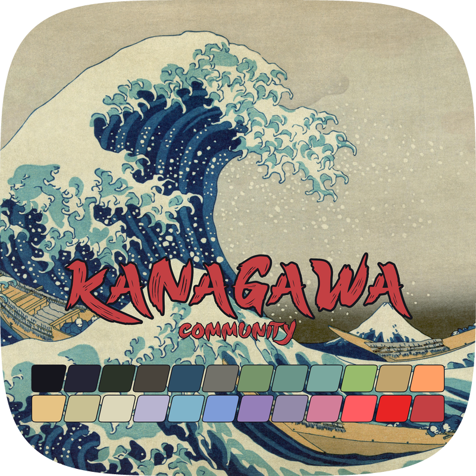

<h3>Kanagawa community</h3>

Community-maintained themes inspired by Hokusai's <em>The Great Wave off Kanagawa</em>.

Using the <a href="https://github.com/rebelot/kanagawa.nvim">Kanagawa palette</a> by <a href="https://github.com/rebelot">Tommaso Laurenzi (rebelot)</a>.

 
 

**Jump to:** [Variants](#variants) · [Ports](#ports) · [Governance](https://github.com/kanagawa-community/.github/blob/main/.github/GOVERNANCE.md) · [Dictionary](https://github.com/kanagawa-community/.github/blob/main/DICTIONARY.md) · [Contribute](https://github.com/kanagawa-community/.github/blob/main/.github/CONTRIBUTING.md) · [Support](https://github.com/kanagawa-community/.github/blob/main/.github/SUPPORT.md)

This community is independent of the original project. It does not represent
or replace the original maintainers.

## Variants

- 🌊 Wave (`wave`): the default dark variant.
- 🐉 Dragon (`dragon`): a darker variant for late-night sessions.
- 🪷 Lotus (`lotus`): the light variant.

## Ports

A port is a Kanagawa implementation for one application. Each port documents its
installation, supported variants, and application-specific configuration.

| Application | Variants | Repository |
| --- | --- | --- |
| Neovim | Wave, Dragon, Lotus | [kanagawa-community/neovim](https://github.com/kanagawa-community/neovim) |

The Neovim port is derived from [rebelot/kanagawa.nvim](https://github.com/rebelot/kanagawa.nvim).

### Moving to their own repositories

Terminal, editor, and desktop themes are being split out of the Neovim
repository's `extras` folder, one repository per application. Each will be
adopted under the [governance lifecycle](https://github.com/kanagawa-community/.github/blob/main/.github/GOVERNANCE.md)
before it is listed above.

Alacritty · Aerc · Alfred · Awesome · Base16 · Broot · Emacs · Fish · Foot ·
Ghostty · Gogh · Helix · Hyprland · iTerm · Kitty · Micro · Mintty · Ptyxis ·
Pywal · Sway · tmTheme · WezTerm · Windows Terminal · Wofi · Xresources · Zathura

To request a port for your application, open a
[port request](https://github.com/kanagawa-community/.github/issues/new?template=port-request.yml).
The [governance guide](https://github.com/kanagawa-community/.github/blob/main/.github/GOVERNANCE.md)
explains how requests are accepted, adopted, and archived.

## Contribute

Report bugs and suggest improvements in the relevant port's issue tracker. For
shared resources, the dictionary, or governance, open an issue in
[this repository](https://github.com/kanagawa-community/.github/issues). Read
[CONTRIBUTING.md](https://github.com/kanagawa-community/.github/blob/main/.github/CONTRIBUTING.md)
before opening a pull request, and see
[SUPPORT.md](https://github.com/kanagawa-community/.github/blob/main/.github/SUPPORT.md)
for where to ask questions.

## Community

Everyone taking part is expected to follow the [Code of Conduct](https://github.com/kanagawa-community/.github/blob/main/.github/CODE_OF_CONDUCT.md).
Report a suspected security issue privately through the
[security policy](https://github.com/kanagawa-community/.github/blob/main/.github/SECURITY.md).

Kanagawa's visual identity is inspired by Hokusai's *The Great Wave off Kanagawa*.
The organization's structure is inspired by [Catppuccin](https://github.com/catppuccin).
