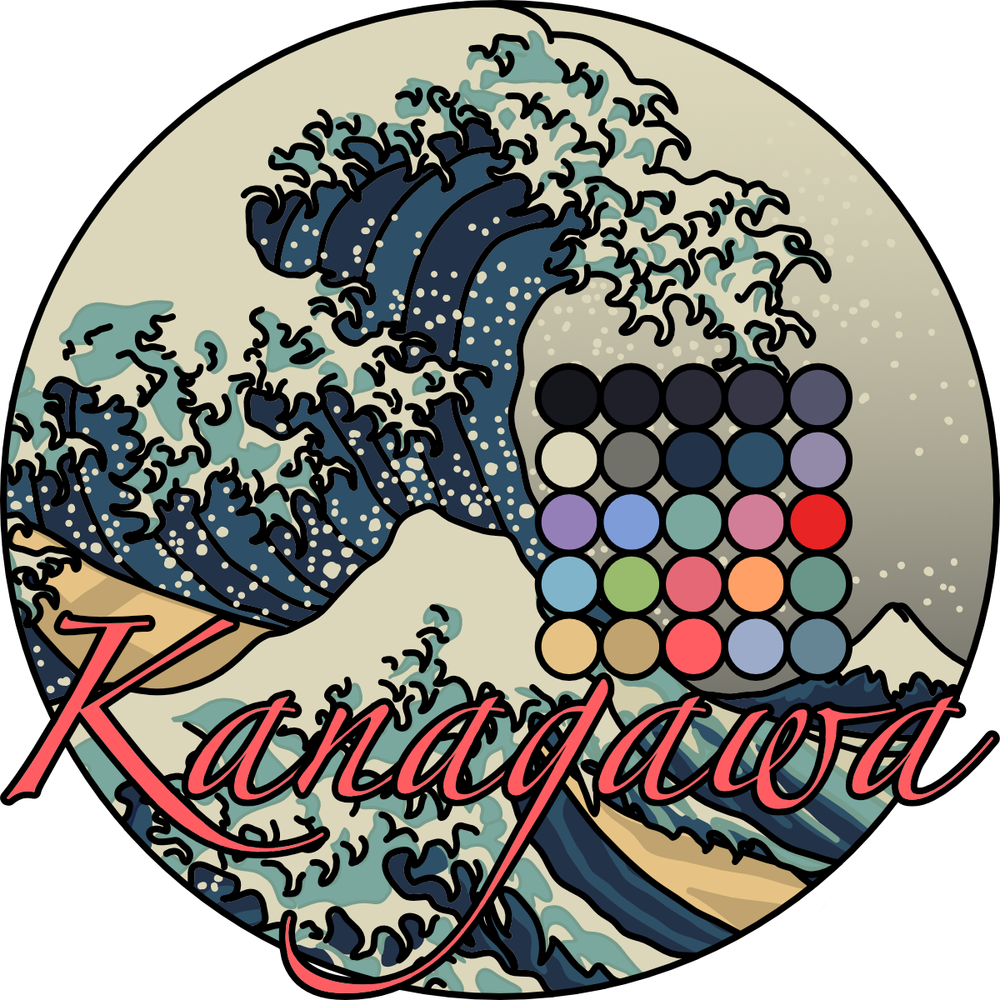

<!-- Replace placeholders. APPLICATION_URL should point to the app's website, or its repository if no site exists. -->
<table role="presentation">
  <tr>
    <td align="center" valign="middle" width="220">
      
    </td>
    <td valign="middle">
      <h1>Kanagawa for <a href="{{APPLICATION_URL}}">{{APPLICATION}}</a></h1>
      
Community-maintained Kanagawa theme for {{APPLICATION}}, inspired by Katsushika Hokusai's <em>The Great Wave off Kanagawa</em>.

      <!-- Wave accents: carpYellow, crystalBlue, autumnRed. Lotus accents: lotusYellow, lotusBlue4, lotusRed. -->
      

        <a href="https://github.com/kanagawa-community/{{REPOSITORY}}/stargazers">
          <picture>
            <source media="(prefers-color-scheme: dark)" srcset="https://img.shields.io/github/stars/kanagawa-community/{{REPOSITORY}}?style=for-the-badge&amp;labelColor=1F1F28&amp;color=E6C384">
            <source media="(prefers-color-scheme: light)" srcset="https://img.shields.io/github/stars/kanagawa-community/{{REPOSITORY}}?style=for-the-badge&amp;labelColor=F2ECBC&amp;color=77713F">
            
          </picture>
        </a>
        <a href="https://github.com/kanagawa-community/{{REPOSITORY}}/releases/latest">
          <picture>
            <source media="(prefers-color-scheme: dark)" srcset="https://img.shields.io/github/v/release/kanagawa-community/{{REPOSITORY}}?style=for-the-badge&amp;label=release&amp;labelColor=1F1F28&amp;color=7E9CD8">
            <source media="(prefers-color-scheme: light)" srcset="https://img.shields.io/github/v/release/kanagawa-community/{{REPOSITORY}}?style=for-the-badge&amp;label=release&amp;labelColor=F2ECBC&amp;color=4D699B">
            
          </picture>
        </a>
        <a href="https://github.com/kanagawa-community/{{REPOSITORY}}/issues">
          <picture>
            <source media="(prefers-color-scheme: dark)" srcset="https://img.shields.io/github/issues/kanagawa-community/{{REPOSITORY}}?style=for-the-badge&amp;labelColor=1F1F28&amp;color=C34043">
            <source media="(prefers-color-scheme: light)" srcset="https://img.shields.io/github/issues/kanagawa-community/{{REPOSITORY}}?style=for-the-badge&amp;labelColor=F2ECBC&amp;color=C84053">
            
          </picture>
        </a>
      

    </td>
  </tr>
</table>

<!-- Replace source placeholders; if source is not on GitHub, use its absolute URL. -->
Part of the independent [kanagawa-community](https://github.com/kanagawa-community)
ecosystem.

<!-- Optional: credit a specific implementation, palette, or other source when applicable. -->
<!-- Example: Based on [source name](https://absolute-source-url). -->

## Variants

<!-- Keep screenshots in this port repository. Use comparable application content in each. -->
<table>
  <thead>
    <tr>
      <th scope="col">🌊 Wave</th>
      <th scope="col">🐉 Dragon</th>
      <th scope="col">🪷 Lotus</th>
    </tr>
  </thead>
  <tbody>
    <tr>
      <td></td>
      <td></td>
      <td></td>
    </tr>
  </tbody>
</table>

## Requirements

- {{APPLICATION}} {{MINIMUM_VERSION}}
- {{OTHER_REQUIREMENT}}

## Installation

{{INSTALLATION_INSTRUCTIONS}}

## Usage

{{QUICK_START_EXAMPLE}}

<!-- Optional sections: keep only those useful for this port. -->

<!--
## Configuration

{{CONFIGURATION_DETAILS}}
-->

<!--
## API

{{PUBLIC_API_DETAILS}}
-->

<!--
## Integrations

{{INTEGRATION_DETAILS}}
-->

<!--
## Palette

{{PALETTE_DETAILS}}
-->

<!--
## Accessibility

{{ACCESSIBILITY_DETAILS}}
Describe tested foreground/background pairs and known limitations. Avoid blanket
WCAG claims unless verified.
-->

## Issues and contributions

Report bugs and request changes in this port's
[issue tracker](ISSUES_URL). Contributions are welcome.

<!-- If this repository has a contributing guide, link it here; otherwise remove this comment. -->
<!-- See [CONTRIBUTING.md](CONTRIBUTING.md). -->

## License

{{LICENSE_TYPE}}. See [LICENSE](LICENSE).
